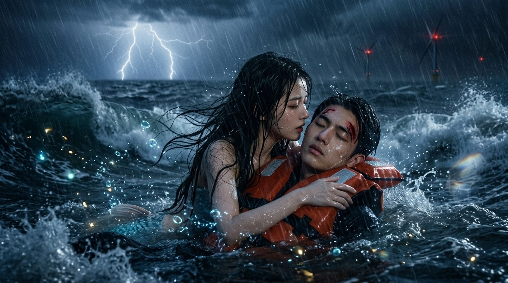

## 台风夜

人鱼的王国在东海最深的那道海沟里。

那里没有阳光，只有一些会发光的东西：水母，灯笼鱼，还有珊瑚礁上一簇一簇的磷光藻，像谁在海底撒了一把碎星星。人鱼的宫殿是用沉船的骨架和珊瑚搭起来的，窗户镶着贝壳，屋顶铺着一层厚厚的海葵，水流过去的时候，整座宫殿都在轻轻摇晃，像在呼吸。

汐是人鱼王最小的女儿。她上面有五个姐姐，每一个都比她漂亮，比她安静，比她懂事。只有她，从小就喜欢往上游。

姐姐们喜欢在宫殿的花园里种红色的海藻，摆成太阳的形状。汐的花园里什么都没有种，只放着她从海底捡来的东西：一只生了锈的怀表，一个半透明的塑料娃娃，一块写着字的铁牌，还有一部屏幕碎掉的手机。她不知道这些东西是做什么用的，只知道它们都是从上面掉下来的，从那个有阳光、有风、有人类的地方。

祖母说，人鱼满十八岁，才可以浮出海面。

「上面有什么？」汐问过很多遍。

「上面有船。」祖母说，「以前是木头的，有帆，风一吹就走。后来变成铁的，会冒黑烟，会轰隆隆地响，响得我们耳朵疼。再后来，船越来越大，大得像一座岛，船上装满了一个一个铁箱子。」

「还有呢？」

「还有城市。夜里亮得跟白天一样，比海底所有的磷光藻加起来还亮。还有人。人类没有尾巴，用两条腿走路，他们活不长，几十年就死了。」

「那他们死了以后呢？」

祖母沉默了一会儿。

「我们人鱼能活三百年。」她说，「可是我们死了，就变成海上的泡沫，什么都不剩。人类不一样，人类有灵魂。人死了，身体没了，灵魂还在，会飞到很高很高的地方去，比云还高，比星星还高。那是我们永远去不了的地方。」

汐那时候还小，听不太懂。她只是觉得，能飞到比星星还高的地方，一定是一件很好的事。

这些年，海越来越吵了。

祖母年轻的时候，海里最大的声音是鲸。鲸的歌能传几百公里，从这片海传到那片海，人鱼听得懂它们在唱什么：哪里有磷虾，哪里有风暴，谁的孩子出生了，谁老了，要沉到海底去了。可是现在，鲸的歌越来越少，船的声音越来越多。螺旋桨的轰鸣，声呐的尖叫，海底挖沙船的震动，日夜不停。有一年春天，一头年轻的抹香鲸搁浅在海边，人鱼们去看它，它的肚子里塞满了塑料袋。

还有那片铁做的森林。

三年前，东海上竖起了第一架风机。后来是十架，五十架，一百多架。白色的塔柱从海底长出来，顶上三片巨大的叶片，日夜不停地转。夜里，每一架风机顶上都亮着一盏红灯，一明一灭，一明一灭。姐姐们说那是人类的眼睛，叫汐别靠近。

汐十八岁生日那天，正好赶上台风。

那是 2026 年 9 月，台风「海葵」在东海登陆的前一夜。海面上的浪有好几层楼那么高，天和海搅成一片，分不清哪里是上，哪里是下。姐姐们劝她换个日子，她不肯。她等这一天等了十八年，一天都不想再等。

她浮出海面的那一刻，雨点像碎石一样砸在脸上。

她第一次看见天空。没有星星，也没有月亮，只有翻滚的乌云，低得好像伸手就能碰到。闪电劈下来，一瞬间把整片海照得雪白，她看见了那片风电场。一百多架白色的风机立在狂风里，叶片已经停了，锁死在那里，只有顶上的红灯还在一明一灭，像一群在暴雨里不肯睡的巨人。

风电场边上停着一艘船，船身上写着几个白色的大字，她不认识。船上的灯全亮着，有人在甲板上跑来跑去，大声喊着什么，声音一出口就被风撕碎了。一架风机的检修平台上，还有几个穿橙色衣服的人，腰上拴着绳子，正一点一点往下撤。

汐游近了一些，躲在一个浪头后面看。

就在这时，一阵怪风横扫过来。她看见平台上最后一个人被风掀了起来，腰上的绳子绷得笔直，然后「啪」地断了。

他掉了下来。

从那么高的地方掉进海里，浪一下就把他吞没了。汐想都没想，一个猛子扎了下去。

水下比水上安静得多，浪的声音变得闷闷的。她在一片翻涌的白色气泡里找到了他。他穿着橙色的救生衣，头盔已经不见了，额角破了一道口子，血一沾海水就散开，像一缕红色的烟。他闭着眼睛，一动不动。

汐从背后托住他，往上游。

人类真重啊，比她想象的重得多。救生衣让他浮在水面上，可是浪一个接一个打过来，每一个都想把他从她怀里夺走。她不敢松手，只能死死抱着他，拖着他往岸边游。

她游了整整一夜。

他一直昏迷着，嘴唇冻得发紫，身上冷得像一块石头。汐不知道人类怕冷，她只是本能地觉得，他需要一点什么。于是她贴着他的耳边，轻轻地唱歌。

那是人鱼哄刚出生的小鱼睡觉时唱的歌。没有词，只有调子，在浪里一起一伏，像潮水涨了又退，退了又涨。小时候，母亲就是这样唱给她听的。母亲说，听到这首歌的孩子，就不会害怕了。

唱到后半夜，风小了一些。她低头看他，借着远处风机的红光，第一次看清了他的脸。

那是一张很年轻的脸，眉毛很浓，鼻梁很直，睫毛上挂着水珠。他睡着了一样，眉头却皱得紧紧的，像在做一个很长、很累的梦。汐伸出手，轻轻把他眉心的皱纹抚平。

他的眉头松开了一点。

她忽然觉得心里有个地方，软了一下。

天快亮的时候，她终于看见了陆地。那是一片小小的海湾，沙滩是灰白色的，后面是一片防风林，再后面是一排矮矮的房子。台风已经过去了，海面上漂着折断的树枝和翻倒的浮标，天边透出一点灰蒙蒙的光。

她把他推上沙滩，让他平躺着，脸朝着天。他的胸口还在起伏，很微弱，但还在。

她不能再往前了。人鱼的尾巴在沙子上寸步难行，而且天就要亮了，人类就要醒了。她躲到礁石后面，只露出一双眼睛，看着他。

不知道过了多久，沙滩那头来了一个女孩。

女孩穿着一件绿色的志愿者马甲，戴着橡胶手套，一手拎着一个大塑料袋，一手拿着长长的夹子，在沙滩上捡台风冲上来的垃圾。她走得很慢，边走边低头，捡起一个塑料瓶，又捡起一只破拖鞋。

然后她看见了他。

女孩尖叫了一声，扔下袋子跑过去，跪在他身边，摸他的脸，探他的鼻息。她掏出手机，手抖得几乎拿不住，对着手机大声说着什么。过了一会儿，她脱下自己的外套，盖在他身上，然后一直握着他的手，一直跟他说话，好像只要她不停地说，他就不会死。

很久以后，远处传来一阵刺耳的声音，由远及近，越来越响。一辆白色的车停在防风林外面，几个穿白衣服的人抬着担架跑过来，把他抬上去，又跑回去。女孩跟着他们一起走了。

沙滩上只剩下那个装垃圾的塑料袋，被风吹得哗啦哗啦响。

汐在礁石后面待了很久，久到太阳完全升起来，久到潮水涨上来，漫过了他躺过的那片沙子，把他留下的痕迹一点一点抹平。

她第一次知道，原来人鱼的心，也会疼。

## 沉船里的女巫

从那以后，汐每天都往上游。

姐姐们以为她只是贪玩，刚满十八岁的人鱼都这样，对上面的一切都好奇，过一阵子就腻了。她们不知道，汐每天浮出海面，只去两个地方。一个是那片灰白色的小海湾，一个是那片风电场。

她在海湾的礁石后面等过很多个早晨。捡垃圾的志愿者来了又走，遛狗的老人来了又走，有一回还来了一对拍婚纱照的新人，新娘的白裙子被海风吹得鼓鼓的，像一朵巨大的水母。可是他再也没有来过。

半个月后，她在风电场又看见了那艘船。

船身上的白色大字她后来才认得，叫「海洋研究所·探海三号」。船开得很慢，在风机之间绕来绕去，每到一个地方就停下来，有人从船尾放下去一个黑色的圆筒，拴着长长的线，一直沉到海底。

她游到船底下，贴着冰凉的船壳，听上面的人说话。

人类的语言她听不太懂，可是她听得出他的声音。那个声音她只听过一次，是在台风夜里，他昏迷中含糊地哼了一声。可她就是认得。

「小陆，你伤还没好利索，就跟着出海，不要命啦？」一个粗嗓门的男人说。

「没事，王叔，缝了七针而已。」他笑着说，「这批水听器再不放下去，就赶不上白海豚的繁殖季了。」

「你小子命大。那天要不是那个姑娘，你就喂鱼了。」

「是啊。」他停了一下，「等这趟回去，我得好好请人家吃顿饭。」

汐在船底下，一动不动地听着。

她慢慢拼凑出了他的样子。他叫陆沉舟，二十七岁，是海洋研究所的声学研究员。那个黑色的圆筒叫水听器，是一种能在海底听声音的机器。他在海里放了很多这样的机器，录鲸的歌，录海豚的叫声，录鱼群游过时的沙沙声，也录船的轰鸣和打桩机的震动。他想知道，人类造出来的这些声音，到底给海里的生命带来了什么。

那天他放水听器的时候，汐游得很近，近到能看见他的手。那双手很大，骨节分明，手背上有一道新的疤。他把水听器轻轻放进水里，像在放一只小船。

「去吧。」他低声说，「替我好好听听。」

汐忽然很想告诉他：你不用机器，我可以替你听。海里的每一种声音我都认得，哪头鲸在唱歌，唱的是什么，我都能告诉你。

可是她什么都不能说。她是人鱼，他是人类。她只能在船底下，看着他的影子在水面上晃来晃去。

她去找了祖母。

「人鱼能变成人吗？」她问。

祖母正在梳头，银白色的长发在水里散开，像一片月光。听到这句话，她的梳子停住了。

「你见过人类了。」祖母说，不是在问。

汐没有说话。

祖母叹了口气，把梳子放下：「人鱼和人类，是两个世界的生灵。我们有三百年的寿命，没有灵魂。他们只有几十年，却有一个不会死的灵魂。我们羡慕他们，可那是羡慕不来的。」

「真的一点办法都没有吗？」

「有一个办法。」祖母看着她，眼神很复杂，「如果有一个人类，全心全意地爱你，爱你胜过爱他的父母，爱你胜过爱世界上的一切，愿意在所有人面前跟你结为夫妻，那么他的灵魂就会分一部分给你。你就会有一个不死的灵魂，跟他一起，飞到比星星还高的地方去。」

「可是，孩子。」祖母握住她的手，「这种事，几百年来，从来没有发生过。」

那天夜里，汐游出了王国，往北，往更深更暗的地方游去。

海巫住在一艘沉了十几年的货轮里。

那是一艘很大的船，比汐见过的任何一艘都大。它侧躺在海底的泥沙里，船身断成了两截，锈得发红发黑，像一头死去很久的巨兽。船上的集装箱散落一地，有的摔开了，里面的东西漂得到处都是：塑料玩具，运动鞋，成卷的布料，还有一箱一箱泡烂了的纸盒。

船舱里漂满了塑料袋。有白的，有黑的，有印着超市名字的，在幽暗的水里一张一合，像一群死去的水母。汐从它们中间游过去，觉得浑身发冷。

海巫坐在船长室里，四周堆满了她从沉船上捡来的东西。她很老了，老得看不出年纪，皮肤是灰绿色的，像泡了很久的海带。她的指甲很长，上面涂着亮晶晶的红色，那是从一箱指甲油里捡来的。她正对着一面裂了缝的化妆镜，慢悠悠地涂第十根指甲。

「我知道你要来。」她头也不抬，「人鱼王最小的女儿，看上了一个人类小伙子。整片海都知道了。」

汐游到她面前：「我想变成人。」

「我知道。」海巫吹了吹指甲，「腿，我可以给你。我会给你调一瓶药，你天亮之前游到岸边，坐在沙滩上喝下去，你的尾巴就会裂开，变成两条人类说的那种漂亮的腿。」

「谢谢你。」

「别急着谢。」海巫终于抬起头，一双眼睛黄得像两盏旧灯，「这世上没有白给的东西。你要付出代价。」

「什么代价？」

「第一，你的声音。」海巫伸出一根长长的手指，指着她的喉咙，「你们人鱼的声音是全海最好听的，我要它。从今往后，你说不出一个字，也唱不出一个音。」

汐的手不自觉地摸上了自己的喉咙。

「第二，」海巫接着说，「你每走一步，都会像踩在碎玻璃上，疼得钻心，脚底会流血。你们人鱼不知道吧，现在的海滩上，碎玻璃可多了。啤酒瓶，酱油瓶，摔碎的手机屏幕，满地都是。」她咯咯地笑了，「你会走得很好看，轻飘飘的，像在跳舞。可是每一步，都是刀。」

「第三，」海巫的声音沉了下来，「你不能告诉他你是谁。说不出来，写不出来，比划也不行，用人类的那些机器也不行，一个字都不能漏。他得自己爱上你，不靠报恩，不靠可怜。」

「如果他爱上了别人呢？」汐问。

「那你就完了。」海巫说，「如果他爱上别人，跟别人结了婚，婚礼之后的第一个黎明，你的心就会碎掉，你会变成海上的泡沫。没有三百年了，也没有灵魂。什么都没有。」

船舱里安静了很久。那些塑料袋还在一张一合，一张一合。

「你还要吗？」海巫问。

汐抬起头：「我要。」

海巫看了她很久，然后叹了一口气。那口气很长，长得不像是一个巫婆该有的。

「傻孩子。」她低声说，「几百年了，来找我的都是你这样的傻孩子。」

她从身后的柜子里拿出一只小小的玻璃瓶，里面装着一种透明的液体，像海水，又比海水亮，在昏暗的船舱里微微发着光。她用一把小刀划开汐的喉咙下面，汐没有感到疼，只觉得有什么东西被轻轻地抽走了，像一根线，从身体最深的地方被扯了出来。

她张了张嘴，想说话，什么声音都没有。

海巫把药瓶塞进她手里。

「还有一件事。」海巫说，「人鱼是没有眼泪的，你知道吗？你们在水里，哭不哭都一样，所以老天爷没给你们眼泪。等你变成人，你就能哭了。」

她顿了顿，又涂起了指甲。

「这个不收你钱。算我送你的。」

## 碎玻璃上的路

天亮之前，汐游到了那片灰白色的小海湾。

她爬上沙滩，坐在他躺过的那个地方，拔开瓶塞，把药一口喝了下去。

药是冰的，冰得像一把刀，从喉咙一直划到尾巴尖。她疼得眼前一黑，倒在沙子上，什么都不知道了。

醒来的时候，天已经大亮，下着很大的雨。

她低头看自己。那条跟了她十八年的银蓝色尾巴不见了，取而代之的是两条细细的、白白的腿，上面沾满了沙子。她试着动了动脚趾，脚趾听话地动了。她觉得很奇妙，又有点害怕，好像这两条腿是别人的，只是暂时借给她用。

她想站起来。

脚掌刚一挨地，一阵剧痛就从脚底直窜上来，像踩在一地碎玻璃上，又像有无数根针同时扎进肉里。她咬住嘴唇，没有出声。她也出不了声。

她又跌坐回沙子上，抱着膝盖，在雨里发抖。

就是在这时候，她听见了脚步声。

一个人撑着黑伞，沿着沙滩走过来，手里拎着一个工具箱。他走得很快，边走边看手机，好像在找什么东西。走到礁石附近，他停下来，抬头，看见了她。

是他。

陆沉舟愣在原地，伞歪到了一边，雨水浇了他一身。过了好几秒，他才反应过来，扔下工具箱跑过来，脱下身上的冲锋衣，把她整个人裹了起来。

「你没事吧？」他蹲下来，声音很急，「怎么一个人在这儿？你家里人呢？」

汐看着他，看了很久。他额角那道疤已经长好了，变成一条淡粉色的细线。

「你叫什么名字？从哪儿来的？」

她摇摇头，张了张嘴，发不出一点声音。

他明白了什么，眼神软了下来：「没关系，没关系。先别说话，我带你去暖和的地方。」

他把她抱起来。她很轻，他好像没费什么力气。她靠在他胸口，听见他的心跳，咚，咚，咚，跟那天夜里在海上一样。

后来的事情，汐记得不太清楚了。她只记得很多很多的人和很多很多的问题。派出所里，穿制服的人问她叫什么，住哪儿，身份证号多少，她一个都答不上来。他们拿她的指纹去查，什么都查不到。医院里，穿白衣服的人给她做检查，说她身体没什么问题，就是脚底有很多细小的伤口，像是踩过碎玻璃。

「失忆，加上失语。」医生对陆沉舟说，「可能是受了什么刺激。这种情况得慢慢来，急不得。」

派出所说，先联系救助站。陆沉舟看了看缩在长椅角落里的汐，犹豫了一下，说：「要不，先让她住我们研究所的招待所吧？离海近，说不定能想起点什么。我来照看。」

他后来跟她说，他也不知道那天为什么会那么说。

「可能是因为，」他挠挠头，「你看我的那个眼神，好像认识我很久了。」

他给了她一部旧手机，教她打字。

一开始，她连怎么拿手机都不会，屏幕朝下，摁了半天没反应。他也不笑她，手把手地教她：这是开机键，这是输入法，你想说什么，就一个字一个字地点出来，然后点这个喇叭，手机就会替你说。

她学得很快，快得让他吃惊。第一句话，她打的是「谢谢」。手机里的合成语音替她念出来，是一个标准、礼貌、没有温度的女声。

「谢谢。」

他笑了：「不客气。那你叫什么名字？想得起来吗？」

她低头想了想，打了一个字。

「汐。」

「汐？」他念了一遍，「好名字。潮汐的汐。」

他不知道，那是她在海里的名字。是她母亲给她取的，因为她出生的那天夜里，正好是一年里潮水涨得最高的时候。

就这样，汐在城市里住了下来。

一切都是新的。她第一次看见红绿灯，红灯亮的时候所有的车都停下来，绿灯亮的时候所有的车又一起走，像一群听话的鱼。她第一次坐地铁，车厢在地底下飞驰，窗外漆黑一片，她紧紧抓着扶手，以为自己又回到了深海。她第一次走进便利店，货架上摆满了五颜六色的东西，冷柜里的灯照得一切都亮晶晶的，她站在那里看了很久，觉得比人鱼王的宝库还要好看。

她第一次吃到热汤面，是在研究所门口那家小面馆。老板娘端上来一碗，热气扑在她脸上，她吓了一跳，往后一缩。陆沉舟哈哈大笑，把筷子递给她，教她怎么夹。她夹了半天，面条一次次滑回碗里。最后他看不下去，给她换了一把叉子。

那碗面很好吃。她吃得很慢，一根一根地吃，好像要把每一根都记住。

她第一次淋到人间的雨，是从面馆出来的时候。他撑开伞，把她拉到伞下。雨点打在伞面上，噼里啪啦，像无数条小鱼在敲门。她仰起头，看着伞骨上滑下来的水珠，忽然觉得，雨是海在想念天空。

只是走路，一直都很疼。

每一步，脚底都像踩在碎玻璃上。她学会了把脚步放得很轻很轻，轻得像在水里游。她学会了穿厚厚的袜子，把渗出来的血藏住。她学会了在疼得受不了的时候，轻轻抿一下嘴，然后接着走。

陆沉舟带她去研究所，去码头，去海边的观测站。他走得快，走着走着就回头看她，然后放慢脚步等她。

「你走路怎么这么轻？」有一次他问，「跟猫似的，一点声音都没有。」

她在手机上打：「习惯了。」

他以为她是怕生，是在陌生的地方不敢大声走路。他不知道，她每一步，都是踩在刀上。

可她还是想跟着他。

哪怕疼，也想跟着他。

十月初，研究所出海做白海豚调查，他带上了她。

船开出去很远，城市缩成了海平线上一道灰色的线，风电场的白色塔柱在阳光下闪闪发亮。海水是深蓝色的，蓝得发黑。汐趴在船舷上，看着熟悉的海浪一层一层地涌过来，心里有一种说不出的滋味。她离开海还不到一个月，却觉得像过了好多年。

海豚来了。

先是一个，然后是一群。粉白色的背脊一个接一个跃出水面，划出一道一道弧线，又钻进水里，溅起雪白的水花。船上的人都欢呼起来，有人举着相机拼命地拍。

陆沉舟兴奋得像个孩子，抓着她的胳膊，指给她看：「那只，看见没有？背上有道疤的那只，叫阿圆。我认识它三年了，它是这群里最调皮的。」

汐当然认识阿圆。

小时候，阿圆还驮着她游过一整片海湾。那时候阿圆背上还没有那道疤，那道疤是后来被一艘快艇的螺旋桨划的，伤得很深，差点没活下来。是人鱼们把它拖回海沟里，用海藻给它敷了一个月的伤。

阿圆游到船边，探出头，用一双黑豆似的眼睛看着她，看了很久很久。

然后它轻轻地叫了一声。

那叫声很短，很轻，船上的人都没在意。只有汐听懂了。阿圆在问她：你怎么在这里？你的尾巴呢？

她伸出手，阿圆就把额头贴进了她的掌心里。

船上一下子安静了。

陆沉舟愣住了，半天才说出话来：「它……它从来不让人碰的。我跟了它三年，连它的鳍都没摸过。」

汐低着头笑了，在手机上打：「它可能认错人了。」

回去的路上，海风很大，太阳快落山了，整片海被染成了橘红色。汐靠着船舷，闭上了眼睛。

陆沉舟以为她睡着了，脱下外套，轻轻盖在她身上，没有叫醒她。

她其实醒着，只是不想睁开眼睛。

她想，就这样吧。就算一辈子都说不出话，就算每一步都那么疼，能这样待在他身边，也很好。

## 那段录音

研究所的声学实验室在顶楼，晚上没什么人。

陆沉舟经常一个人在这里待到半夜。实验室里堆满了机器，屏幕上跳动着一条一条彩色的波纹，他说那叫声谱图，是声音的样子。鲸的歌是一道一道弯弯的长弧，像海浪；海豚的哨声是细细的、往上翘的线，像小鱼的尾巴；船的轰鸣是一大片模糊的色块，从屏幕底部一直糊到中间，什么都盖住了。

「你看。」他指着屏幕，「这是十年前录的，这是今年录的。同一片海，同一个季节。」

汐看过去。十年前的那张图上，鲸的长弧一道接一道，密密麻麻，像一首很长的歌。今年的那张图上，只剩下零零星星几道，被船的色块挤在角落里，像几声叹息。

「它们越来越少了。」他说，「也越来越安静了。不是它们不想唱，是唱了也没人听得见。」

汐想起祖母说过，她年轻的时候，鲸的歌能从这片海一直传到那片海。

那天晚上，他忽然说：「给你听个东西。」

他打开一个文件夹，点开一段音频，把耳机递给她。

「这是台风那天晚上，风电场底下的水听器录到的。」他说，「就是我掉进海里的那天。后来我昏过去了，什么都不记得。可我总觉得，迷迷糊糊中，有人在我耳边唱过歌。」

汐戴上耳机。

先是风声，呼呼的，像一头巨兽在喘气。然后是浪声，一层压着一层，轰隆隆的。然后，在那些声音的缝隙里，有一个很轻很轻的声音，一起一伏，一起一伏。

是她的声音。

是她在台风夜里，贴着他的耳朵，唱给他听的那支歌。没有词，只有调子，像潮水涨了又退，退了又涨。

汐的手在发抖。她以为自己再也听不到自己的声音了。可它就在这里，被一个黑色的圆筒从海底捞了上来，存进了一台冰冷的机器里，存了一个多月，等着她来听。

「我比对了所有的数据库。」陆沉舟的声音从很远的地方传来，「国内的，国外的，所有已知的海洋生物，一个一个地比。不是鲸，不是海豚，不是任何一种鱼。频率不对，结构也不对。」

他笑了一下，有点不好意思：「说出来你可能不信。我觉得那是一个人，一个女孩子，在水下唱歌。」

「我知道这不科学。人在水下根本发不出这种声音。可我就是这么觉得。」他看着屏幕上那条细细的、一起一伏的波纹，「我找了她一个多月了。我想找到她，跟她说一声谢谢。」

汐摘下耳机，拿起手机。

她要告诉他。现在就告诉他。那是我，是我唱的，是我把你从海里拖上岸的，是我在你耳边唱了一整夜的歌。

她的手指刚碰到屏幕，就麻了。

那种麻不是冷，也不是疼，而是一种奇怪的空，好像手指一下子不是自己的了，像两根泡在水里的海藻。她拼命地点，屏幕上跳出来一串乱码，歪歪扭扭的，像一串往上浮的气泡。

她删掉，再打。还是乱码。

她咬着牙，换了一只手。还是一样。

她想起海巫的话：说不出来，写不出来，比划也不行，用人类的那些机器也不行。一个字都不能漏。

「你怎么了？」陆沉舟有点担心地看着她，「手不舒服吗？」

她摇摇头，把乱码全部删掉，慢慢地打了三个字。

「很好听。」

合成语音念出来，平平淡淡的，像在念天气预报。

「是吧？」他笑了，眼睛亮亮的，「我也觉得。我听了几百遍了，还是觉得好听。」

那天晚上，汐回到招待所，坐在床边，看着窗外的海，坐了一整夜。

后来她又试过很多次。

她试过用笔在纸上写。笔尖一碰到纸，字就变成了一团一团的墨，像被水泡过。她试过画画，画一条有尾巴的女孩，抱着一个人在浪里游。可是画出来的东西，连她自己都认不出是什么。她甚至试过拉着他的手，把他带到那片灰白色的小海湾，指着礁石，指着海，指着自己。

他只是困惑地看着她，然后笑了：「你喜欢这儿？那以后周末我常带你来。」

她放弃了。海巫说得对，一个字都不能漏。

过了几天，陆沉舟说，他找到那天救他的人了。

「其实也不算找到。」他说，「是派出所给的联系方式，打急救电话的那个女孩。我一直想当面谢谢她，一直没腾出空来。这周六约了吃饭，你也一起来吧。」

汐点了点头。

那个女孩叫林晚，是海边那家医院的护士。她就是台风后的那个早晨，穿着绿马甲在沙滩上捡垃圾的志愿者。

林晚长得很好看，不是那种让人一眼就记住的好看，而是越看越舒服的那种。她说话轻声细语的，笑起来眼睛弯弯的，像月牙。吃饭的时候，她一直在给汐夹菜，也不因为汐不会说话就把她晾在一边，每说一句话都会转过头来，等汐在手机上打完字回答。

「那天真是吓死我了。」林晚说，「我捡垃圾捡到一半，看见沙滩上躺着一个人，一动不动的，我还以为……」她拍拍胸口，「幸好你命大。」

「是你救了我。」陆沉舟认真地说，举起杯子，「这杯我敬你。」

林晚的脸红了，摆摆手：「我就打了个电话，哪算救啊。」

「你一直握着我的手，跟我说话。」他说，「急救的医生说了，那种时候，有人跟你说话，你就能撑下去。」

林晚低着头笑了，没有再推辞。

汐坐在对面，看着他们。她发现自己没有办法讨厌林晚。

那顿饭吃到一半，汐起身去洗手间，走得急了，脚底的伤口裂开，血从袜子里渗了出来，在白色的地砖上留下了一个淡淡的红印。

林晚跟了出来，在走廊里拉住她。

「你脚怎么了？」她蹲下来，轻轻掀开汐的裤脚，看见了被血浸透的袜子，倒吸了一口凉气，「天哪，这得多疼啊。你怎么一声都不吭？」

她从包里翻出碘伏和创可贴，那是她做护士的习惯，走到哪儿都带着。她让汐坐在走廊的长椅上，脱掉袜子，一点一点地给她清理伤口，动作轻得像在给一只受伤的小鸟包扎。

「傻姑娘。」她边包扎边说，「疼就要说出来啊。哪怕说不出来，也要让人知道。」

汐看着她低垂的睫毛，眼眶有点发热。可是她没有眼泪。人鱼是没有眼泪的。

包扎完，林晚没有马上站起来。她犹豫了一下，压低声音说：「汐，有件事我一直没跟他说。」

汐看着她。

「那天早上，我看见他的时候，他身边的沙子上有一道痕迹，很长很长，从海里一直拖到他身边。」林晚皱着眉，「像是有什么东西，把他从海里拖上来的。可是我看了一圈，沙滩上一个人都没有。」

「我一直没想明白。」她笑了笑，摇摇头，「可能是浪冲的吧。」

汐低下头，手指紧紧攥着衣角。

她多想告诉林晚：不是浪。是我。

可她什么都说不出来。

## 婚礼

那年冬天，陆沉舟和林晚在一起了。

汐是看着他们一点一点走近的。从第一顿饭，到第二顿饭，到周末一起去海边捡垃圾，到他加班的夜里，林晚提着保温饭盒出现在实验室门口。他接饭盒的时候会有点手足无措，耳朵尖红红的。汐从来没见过他那个样子。

她没有躲开。她还是每天跟着他，去研究所，去码头，去观测站。只是走路的时候，她会离他远一点，再远一点。

有时候三个人一起吃饭，林晚会特意坐到汐旁边，给她夹菜，问她脚还疼不疼，新换的药好不好用。有一回林晚织了两条围巾，一条灰的给他，一条白的给汐。

「天冷了，」林晚帮她把围巾绕上，「你老是穿那么少，看着就冷。」

汐摸着那条柔软的围巾，在手机上打：「谢谢姐姐。」

林晚愣了一下，然后笑了，眼睛弯弯的：「你叫我姐姐啊。那以后我就是你姐姐了。」

汐想起了海底的五个姐姐。她已经很久没有见到她们了。

十二月初的一个傍晚，陆沉舟约她去码头。

夕阳把整片海染成了橘红色，渔船一艘一艘地回港，船上的人吆喝着卸货，海鸥在头顶盘旋。他们坐在码头尽头的栏杆上，脚下就是海，浪一下一下地拍着水泥墩子。

他说得有些不好意思，挠了挠头：「汐，我要跟你说个事。我跟晚晚，打算结婚了。」

汐看着海面，很久没有动。

「就在跨年那天。」他接着说，「她说想在新年的第一天，和我一起看日出。」

「她是个很好的人。」他看着远处，声音很轻，「那天要不是她，我可能就死在沙滩上了。这条命，算是她给的。」

汐拿出手机，一个字一个字地打。

「恭喜你。」

合成语音念出来，还是那个标准、礼貌的女声，听不出一点难过。

她第一次觉得，没有声音也挺好的。如果用自己的声音说这句话，她大概会说不完。

「你会来的吧？」他问，「婚礼那天。」

她点点头。

他松了一口气，又看向远处的风电场。那些白色的风机在夕阳里变成了金色，叶片慢慢地转着。

「要是能找到那个唱歌的人就好了。」他像是在自言自语，「我总觉得，我还欠她一声谢谢。」

海风吹过来，把她的头发吹乱了。她没有去理。

婚礼在海边的一家酒店里办。

那天天气很好，冬天的太阳暖洋洋的，海面平静得像一面镜子。酒店的草坪上搭了白色的拱门，缠满了白色的绣球花和浅蓝色的丝带。草坪尽头就是沙滩，再往外，就是那片海。

汐穿着林晚陪她去挑的浅蓝色裙子，系着那条白色的围巾，坐在最后一排。从酒店门口走到座位，不过几十步路，她却走了很久。新鞋子很硬，脚底的伤口又裂开了，她能感觉到血慢慢地渗进了鞋里，黏黏的，热热的。

音乐响起来。林晚穿着婚纱，挽着父亲的手，从拱门那头走过来。她真好看啊，白纱拖在草地上，像一朵慢慢漂过来的浪花。陆沉舟站在拱门下等她，穿着一身黑色的西装，紧张得手都不知道往哪儿放。

司仪说：「新郎，你可以亲吻新娘了。」

所有人都在鼓掌，在欢呼。

汐也跟着鼓掌。她拍得很用力，手掌都拍红了。

晚宴开始前，司仪请新人跳第一支舞。

灯光暗下来，音响里传出来的不是什么婚礼进行曲，而是风声，浪声，还有一个很轻很轻的声音，一起一伏，一起一伏。

汐浑身一震。

陆沉舟拿着话筒，有点不好意思地对宾客们说：「这段音乐有点特别，是我在台风那天晚上录到的。到现在我也不知道是谁在唱，可我一直觉得，是这首歌让我撑过了那一夜。今天我想用它，来跳我人生中最重要的一支舞。」

宾客们发出一阵感动的低语。林晚靠在他怀里，两个人随着那支没有词的歌，慢慢地转着圈。

汐坐在最后一排，听着自己的声音，从音响里一遍一遍地流出来。

那是她唱给他的歌。现在，他和别人，伴着它跳舞。

她低下头，看着自己放在膝盖上的手，一动也没有动。旁边一位阿姨碰了碰她，笑着说：「小姑娘，这歌真好听，是吧？」

她点点头。

那天夜里，宾客散尽，酒店安静下来。新人住在酒店顶楼的套房里，套房有一个很大的阳台，正对着海。

汐一个人走到沙滩上，脱掉鞋子，把流血的脚泡进冰凉的海水里。海水碰到伤口，疼得她浑身一颤，可是很快，那种疼就变得很熟悉，很温柔，像是被谁轻轻抱住了。

然后，她看见海面上浮起了五个影子。

是她的姐姐们。

月光下，她们的脸白得发青。汐愣住了，因为她们的长发都不见了。人鱼最珍惜的就是头发，姐姐们的头发曾经长得能拖到尾巴尖，在水里散开的时候像一片片海藻林。可是现在，她们的头发都被剪得短短的，参差不齐，贴在头皮上，像一群刚被救上岸的落水者。

「我们把头发给了海巫。」大姐游到她面前，声音沙哑，「换来了这个。」

她从水里举起一把刀。刀很小，刀刃又薄又亮，在月光下泛着一种冷冷的青色。

「海巫说，天亮之前，把这把刀刺进他的心口。」大姐把刀柄塞进汐的手里，「他的血滴在你脚上，你的腿就会重新长成尾巴。你就能变回人鱼，回家，还能活三百年。」

「回来吧，汐。」二姐哭着说，「祖母为了你，头发都白了。」

「你不回来，天一亮，你就变成泡沫了。」三姐说，「我们再也见不到你了。」

「快去。」大姐握住她的手，「天快亮了。」

姐姐们沉了下去，海面上只剩下一圈一圈的涟漪。

汐握着那把刀，站在海边，站了很久。

然后她转身，一步一步地走回酒店，走上楼梯，走到顶楼。套房的门没锁。她轻轻推开门，走了进去。

房间里很暗，只有阳台外面透进来一点月光。他睡得很沉，眉头松开，嘴角带着一点笑，好像在做一个很好的梦。林晚靠在他肩上，手里还握着他的手，无名指上的戒指闪着一点微弱的光。

窗外，风电场的红灯一明一灭，一明一灭，像那个台风夜一样。

汐站在床边，举起了刀。

她想起他在台风夜里冰冷的脸，想起他眉心的皱纹被她抚平的样子。想起他把冲锋衣裹在她身上，想起他手把手教她打字，想起那碗热汤面，想起伞面上噼里啪啦的雨声。想起他指着阿圆，兴奋得像个孩子。想起他在实验室里说：我找了她一个多月了，我想跟她说一声谢谢。

她又想起林晚。想起林晚蹲在走廊里，一点一点给她包扎伤口，说：傻姑娘，疼就要说出来啊。

她站了很久，久到东边的海面开始发白。

然后她放下刀，轻轻地走到阳台上，把刀扔进了海里。

刀在空中划出一道小小的弧线，落进海里，连一点水花都没有溅起来。

## 人鱼的眼泪

汐走下楼梯，穿过空荡荡的大堂，走到沙滩上。

天边已经亮起了一道淡金色的线。那是 2027 年的第一个黎明。

她没有穿鞋，光着脚，一步一步地走向大海。每一步还是那么疼，像踩在碎玻璃上。可是她忽然觉得，这种疼也没有那么难忍了。就像一首很长很长的歌，唱到最后几句，嗓子哑了，人也累了，可是心里是安静的。

海水漫过她的脚背，漫过她的脚踝，漫过她的膝盖。

她停了下来，回头看了一眼。

酒店顶楼的阳台上，门开了。陆沉舟和林晚裹着毯子走了出来，靠在栏杆上，等着看新年的第一场日出。林晚指着海面，好像在说什么，陆沉舟笑着点头，把她搂得更紧了一些。

他们没有看见她。

这样很好，汐想。

太阳出来了。先是一个小小的金点，然后慢慢地变大，变圆，把整片海都染成了金红色。海面上的每一道浪都在发光，风电场的白色风机也在发光，叶片缓缓地转着，像一群刚刚醒来的巨人，在伸懒腰。

她觉得身体在变轻。

先是脚，然后是腿，然后是腰。好像有什么东西在一点一点地化开，像一块糖掉进了温水里。她低头看，海水里冒起了一串一串细小的泡沫，白白的，亮亮的，围着她打转。

原来变成泡沫是这种感觉。不疼，一点都不疼，只是轻。轻得像一首唱完了的歌。

她想起海巫说的话：等你变成人，你就能哭了。

于是她哭了。

那是她第一次哭。眼泪从眼眶里涌出来，热热的，咸咸的，顺着脸颊流下来。她这才知道，原来眼泪是热的。原来人类哭的时候，心里那块堵了很久的地方，会一点一点地松开。

她为那个台风夜哭，为那碗热汤面哭，为阿圆贴在她掌心里的额头哭。为她再也见不到的姐姐和祖母哭，为那支他用来跳舞的歌哭。

也为自己哭。为这短短的、疼痛的、却一点都不后悔的三个月哭。

一滴眼泪落进了海里。

就在这时，她发现自己能出声了。

海巫拿走的声音，在她的身体化开的那一刻，又回到了她的身体里。也许是因为契约结束了，也许是因为海巫也会心软。她张开嘴，那支歌就自己流了出来，没有词，只有调子，一起一伏，一起一伏，像潮水涨了又退，退了又涨。

她唱着歌，化进了海里。

可是她没有消失。

她觉得自己在往上升。比海面高，比风机的叶片高，比那些低低的云还要高。她的四周有很多很多透明的影子，轻飘飘的，像风，又像光。她们围着她，用一种她从来没听过、却一下子就听懂了的语言对她说：

「欢迎你，妹妹。我们是风的女儿。」

「我们没有身体，也没有灵魂。可是我们可以吹过大海，吹过城市，吹过每一个需要我们的地方。我们推着那些白色的风车转，让人类的城市在夜里亮起灯。我们把海上的雨云吹到干旱的田里。我们把夏天的热吹散，把花的香气送到很远的地方去。」

「这样做三百年，」她们说，「我们就会得到一个不死的灵魂。」

汐看着下面那片海，那片风电场，那家海边的酒店。阳台上的两个人还靠在一起，小得像两粒沙子。

她轻轻吹了一口气。

阳台上，林晚的头发被一阵风吹乱了。她伸手拢了拢，忽然觉得那阵风很暖，暖得不像是冬天的风。

同一个早晨，东海最深的那道海沟里，人鱼的宫殿静悄悄的。

五个剪短了头发的姐姐围在祖母身边，谁都没有说话。她们在海面上等了一整夜，等到太阳升起来，等到一片白色的泡沫从岸边漂过来，在她们中间轻轻打了个转，又散开了。她们就知道了。

祖母坐在汐的花园里。那里还是什么都没有种，只放着那些从上面掉下来的东西：生锈的怀表，半透明的塑料娃娃，写着字的铁牌，屏幕碎掉的手机。

祖母一件一件地摸过去，摸了很久。然后她抬起头，看着头顶那片永远照不进阳光的海水，轻声说：

「去吧，孩子。去比星星还高的地方。」

那天早上，研究所的值班员在例行检查数据的时候，发现风电场底下的水听器又录到了那段歌声。

只有短短的十几秒，跟台风那晚的一模一样。然后就再也没有出现过。

值班员把这段音频发给了陆沉舟。他是在度蜜月的路上收到的。

他把车停在海边，戴上耳机，听了一遍，又一遍。

不知道为什么，他突然想起了那个不会说话的女孩。想起她走路时轻轻抿着嘴的样子，想起她袜子上渗出来的血。想起阿圆把额头贴进她的掌心里，想起她第一次听这段录音的时候，那双发抖的手。想起她拉着他去那片小海湾，指着礁石，指着海，指着自己。

林晚坐在副驾驶上，看着他越来越白的脸，忽然轻声说：「沉舟，有件事我一直没告诉你。」

她把那道从海里一直拖到他身边的痕迹，告诉了他。

他打汐的手机，关机。他回研究所的招待所，房间收拾得干干净净，被子叠得整整齐齐，那部旧手机放在枕头上，屏幕已经黑了。那条白色的围巾也叠好了，放在手机旁边。什么都没有带走。

他给手机充上电，开机。

手机里几乎什么都没有。没有照片，没有联系人，只有一个备忘录。他点开，里面存着几十条草稿，日期从十月一直排到十二月的最后一天。

每一条，都是一串乱码。

歪歪扭扭的符号，一行一行，密密麻麻，像一串一串往上浮的气泡。有的只有短短一行，有的长得要往下翻好几屏。他一条一条地往下翻，一个字都看不懂，可是他翻得越来越慢，手越来越抖。

最后一条，是十二月三十一日的深夜，婚礼结束以后存的。

那一条很短。只有两个字是清清楚楚的，夹在一大串乱码中间，像是拼尽了全身的力气，才终于从那些气泡里挣了出来。

「是我。」

陆沉舟坐在那张窄窄的单人床上，握着那部旧手机，坐了很久很久。窗外就是海，浪一下一下地拍着岸，跟台风那晚一样，跟她唱歌的时候一样。

林晚一直站在门口，站了很久，才走进来。她没有说话，只是在他身边坐下，把那条白色的围巾拿起来，贴在自己的脸上。

「她叫过我姐姐。」林晚说着，眼泪就掉了下来，「我给她包扎伤口的时候，她看着我，那个眼神……我早该想到的。」

两个人就那样坐着，谁也没有再说话，一直坐到天黑。

最后，他一个人走到了那片灰白色的小海湾。

潮水退了，沙滩湿漉漉的，在阳光下闪着光。礁石旁边，就是汐第一次被他发现的地方，沙子上躺着一颗小小的珍珠，泛着一层淡淡的蓝光。

他蹲下来，把珍珠捡起来，握在手心里。

那颗珍珠是温的。像刚刚有人在这里哭过。

后来，陆沉舟把那段录音发表在了一本海洋声学的期刊上，在「物种」那一栏，他写的是「未知」。在「备注」那一栏，他只写了一个字：

汐。

再后来，每年跨年的那天清晨，他都会一个人来到这片海边，坐在礁石上，等太阳出来。风很大，吹得他睁不开眼睛。可是他从来不觉得冷。

因为那风，总是暖的。